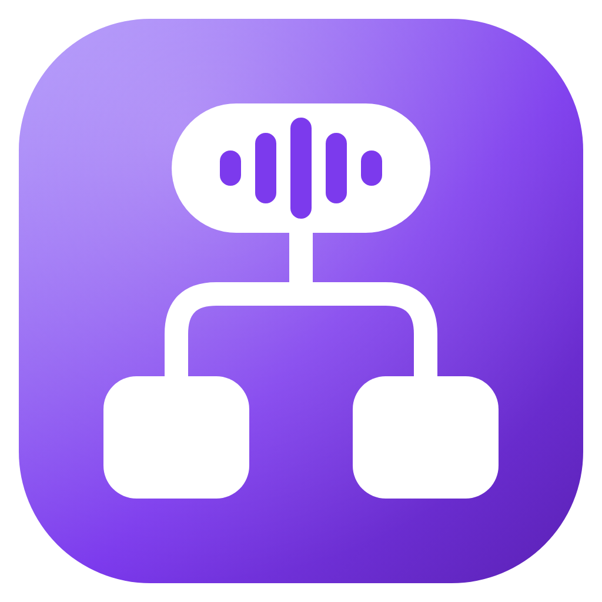
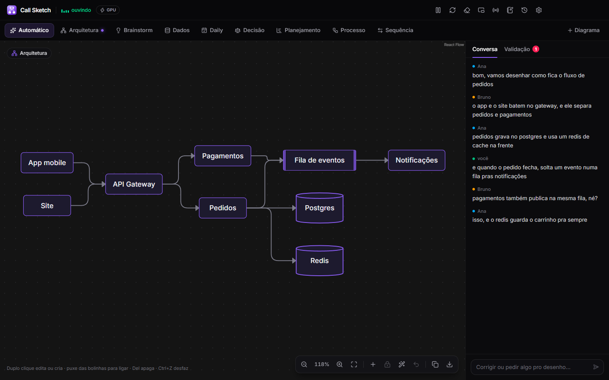
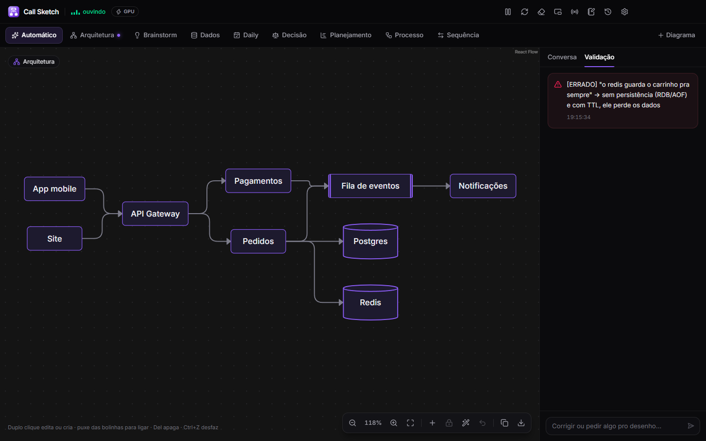
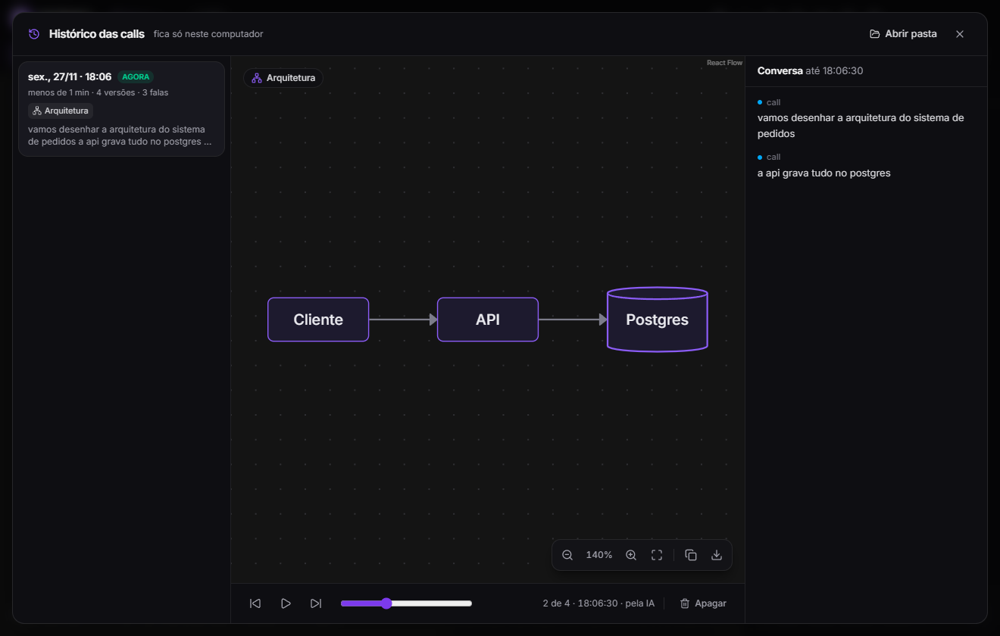
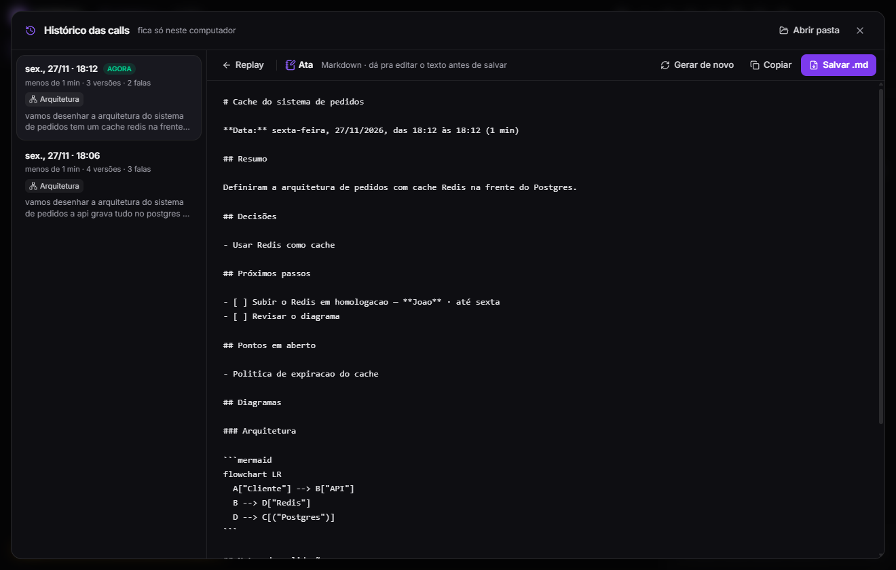
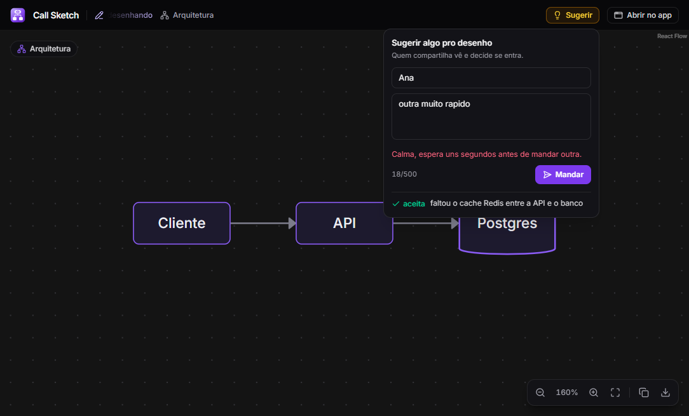
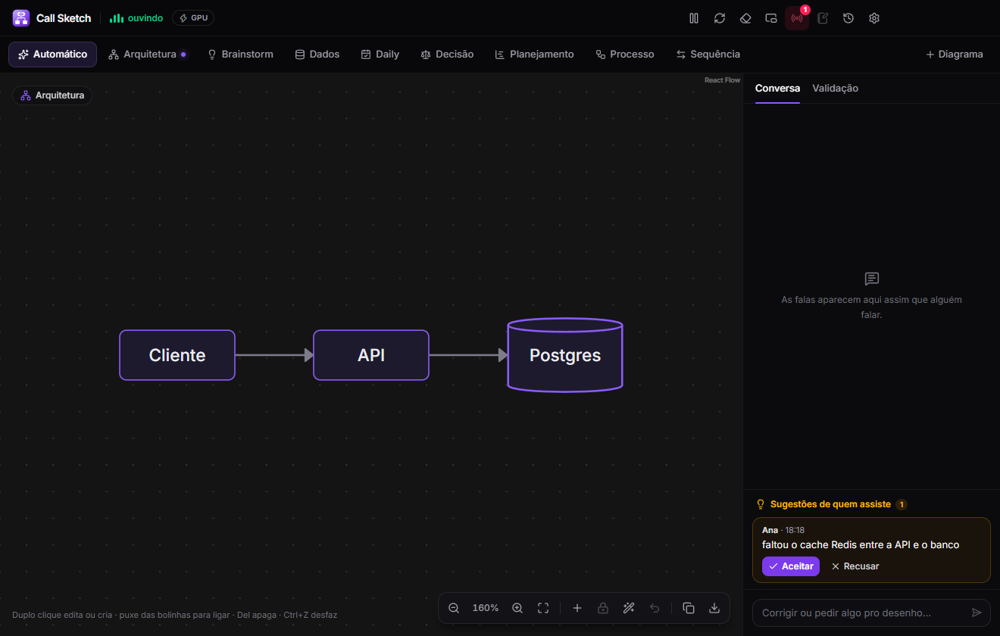

<div align="center">



<h1 style="border-bottom: none">
    <b>Call Sketch</b><br />
    Fale. A IA desenha.
</h1>

<p align="center">
  Ouve a sua call e transforma a conversa em diagramas ao vivo, no seu PC e com a sua IA. <br />
  Arquitetura, processos, mapas mentais e dados, desenhados enquanto vocês falam.
</p>

<div align="center">
    <a href="https://github.com/Guilherme-b-damasio/call-sketch/releases/latest">Baixar</a> |
    <a href="#recursos">Recursos</a> |
    <a href="#modos">Modos</a> |
    <a href="#outras-ias">Outras IAs</a> |
    <a href="#rodar-pelo-código">Rodar pelo código</a>
</div>
<br/>

[](https://github.com/Guilherme-b-damasio/call-sketch/releases/latest)
[](https://github.com/Guilherme-b-damasio/call-sketch/releases)

[](https://www.typescriptlang.org/)
[](https://www.python.org/)

</div>

<br />
<div align="center">
<em>Discord, Meet, Zoom ou qualquer áudio que sai do PC: o que é dito vira desenho, e o desenho continua sendo seu.</em>
</div>
<br />

<div align="center">

</div>

## O que é o Call Sketch

O Call Sketch é um app desktop que fica ouvindo a call (o som que sai do PC mais o seu microfone), transcreve tudo **localmente com o Whisper** e pede para uma IA transformar as falas em um **diagrama que evolui ao vivo**. Ele escolhe sozinho o tipo de desenho (arquitetura, processo, mapa mental, banco de dados…), avisa em voz quando troca e tem um segundo revisor que aponta afirmações técnicas erradas.

Cada pessoa roda no próprio PC com **a própria IA**: o login da assinatura no Claude Code (padrão, sem custo de API), uma chave da Anthropic ou [outra IA](#outras-ias), inclusive um modelo grátis rodando no seu computador.

## Recursos

**O quadro branco que se desenha sozinho**

- Enquanto a conversa anda, a IA vai evoluindo o mesmo diagrama em vez de recomeçar. No modo automático ela escolhe o [modo](#modos) certo e avisa em voz. Dá pra ter **vários diagramas em abas** (um de arquitetura e outro de dados na mesma call) e mandar correções pela caixa de texto: "tira o Auth", "junta as filas".

**Um revisor técnico ouvindo junto**

- Um segundo modelo confere o que é dito e aponta, ao lado, o que está **errado** ou **duvidoso**: um comando trocado, um número estranho, um risco que passou batido.

<div align="center">

</div>

**Edite à mão, a IA respeita**

- Fluxogramas, mapas mentais e diagramas de dados abrem num editor de caixas. Arraste, renomeie, ligue, apague e **trave** o que a IA não pode mudar. Ela continua desenhando por cima da sua versão.

**Quem falou o quê**

- As falas aparecem como **Pessoa 1, Pessoa 2…**, cada uma com uma cor. Clique no nome pra trocar por "Ana" ou "Bruno", e a IA e a ata passam a usar o nome. A separação das vozes é feita por um modelo pequeno que roda na CPU.

**Histórico com replay e ata pronta**

- Cada call fica guardada no seu PC. Dá pra rever o desenho crescendo, versão por versão, com a conversa daquele momento, e gerar uma **ata em Markdown** com resumo, decisões, próximos passos e os diagramas finais.

<table>
  <tr>
    <td width="50%"></td>
    <td width="50%"></td>
  </tr>
</table>

**Todo mundo da call vê, e pode sugerir**

- Um clique gera um link: quem abre no navegador vê o diagrama ao vivo, sem instalar nada, e pode **sugerir** mudanças. Você aceita ou recusa, e o que for aceito vira instrução pra IA. Exporte em **PNG, PDF ou SVG** quando acabar.

<table>
  <tr>
    <td width="50%"></td>
    <td width="50%"></td>
  </tr>
</table>

**Local primeiro, sem servidor no meio**

- O áudio e a transcrição nunca saem do seu PC. Na sessão compartilhada só o **desenho** é enviado, servido pelo seu próprio app através de um túnel grátis da Cloudflare. O histórico fica numa pasta sua.

## Modos

| Modo | Desenha | Quando |
|---|---|---|
| `auto` | a IA escolhe e avisa em voz quando troca | padrão |
| `brainstorm` | mapa mental | chuva de ideias |
| `daily` | um bloco por pessoa: ✅ feito, 🔜 próximo, ⛔ bloqueio | reunião de status |
| `arquitetura` | componentes, bancos, filas e conexões | desenho de sistema |
| `processo` | passo a passo com decisões | fluxos, regras de negócio |
| `sequencia` | diagrama de sequência | integrações, chamadas entre sistemas |
| `dados` | diagrama entidade-relacionamento | modelagem de banco |
| `planejamento` | linha do tempo | roadmap, fases, sprints |
| `decisao` | opções com prós e contras | escolher entre alternativas |

O modo pode ser trocado na barra do app durante a conversa.

**Modos próprios:** em Configurações → Modos → *Abrir pasta*, crie um `.md` no formato dos que estão em [`app/resources/modes/`](app/resources/modes). Um arquivo com o mesmo nome de um modo padrão substitui esse modo.

## Guia rápido

| Atalho | O que faz |
|---|---|
| `Ctrl+Shift+D` | redesenha agora |
| `Ctrl+Shift+P` | pausa / continua |
| `Ctrl+Shift+O` | janela flutuante (sempre por cima da call) |

No canvas, a roda do mouse dá zoom e arrastar o fundo move. A barra embaixo copia o código Mermaid e exporta o desenho (quem assiste pelo navegador baixa PNG e SVG).

<details>
<summary><b>Editar à mão</b></summary>
<br/>

Fluxogramas (arquitetura, processo, decisão, daily), mapas mentais (brainstorm) e diagramas de dados abrem num editor de caixas:

- **Arraste** as caixas para onde quiser. A arrumação fica salva na aba, e quem assiste a sessão vê igual.
- **Duplo clique** numa caixa ou numa ligação edita o texto. No fundo, cria uma caixa nova. Numa entidade, o nome vai na primeira linha e cada campo numa linha (`int id PK`).
- **Puxe das bolinhas** que aparecem na borda da caixa até outra caixa para ligar. No mapa mental, isso muda o galho de lugar.
- **Del** apaga o que estiver selecionado e **Ctrl+Z** desfaz.
- **Travar** (cadeado na barra) marca caixas que a IA não deve mudar. A varinha **reorganiza** tudo de novo.

A IA recebe o diagrama já editado e desenha por cima dele. Sequência e cronograma seguem desenhados pelo Mermaid (só dá pra mudar pelo código ou pedindo na caixa de texto).

</details>

<details>
<summary><b>Quem fala</b></summary>
<br/>

As falas da call aparecem como **Pessoa 1**, **Pessoa 2**… em vez de só "call". Clique no nome pra trocar; vale pra todas as falas daquela pessoa. Ao clicar em Limpar, a contagem recomeça.

A voz de cada frase é reconhecida por um modelo pequeno ([WeSpeaker](https://github.com/wenet-e2e/wespeaker), 26 MB) que roda na CPU, ao lado do Whisper. Ele é baixado do GitHub na primeira vez e conferido pelo SHA-256; dá pra desligar em Configurações → Quem fala. Frases muito curtas (menos de 1 segundo) ficam sem pessoa, e duas pessoas falando na mesma frase contam como uma só.

</details>

<details>
<summary><b>Histórico e ata</b></summary>
<br/>

O relógio na barra de cima abre as calls que já passaram. Cada call vai de quando você abre o app (ou clica em Limpar) até o próximo Limpar, e guarda a conversa, as notas de validação e cada versão de cada diagrama.

- Escolha uma call e use **◀ ▶** ou arraste a barra para ver o desenho crescendo. O play toca a call inteira.
- Ao lado aparece só o que tinha sido falado até aquele momento, e embaixo diz se a versão veio da IA ou foi editada à mão.
- **Ata:** o caderninho na barra de cima (ou "Gerar ata" no replay) pede pra IA um resumo com decisões, próximos passos e pontos em aberto. O app junta o diagrama final de cada aba (em blocos `mermaid`, que GitHub, Notion e Obsidian desenham), as notas de validação e a transcrição. Dá pra editar o texto, copiar ou salvar como `.md`.
- Fica tudo **só neste computador** (as 100 calls mais recentes). Dá pra apagar uma call ou desligar o histórico em Configurações.

</details>

<details>
<summary><b>Sessão compartilhada e sugestões</b></summary>
<br/>

Clique no ícone de transmissão no topo e em **Compartilhar**. O app gera um link; mande no chat da call.

- **Quem abre no navegador** vê o diagrama atualizando sozinho, sem instalar nada.
- **Quem tem o Call Sketch instalado** pode clicar em "Abrir no app" na página, ou colar o link em **Entrar numa sessão**. Enquanto assiste, a escuta dessa pessoa fica pausada (não gasta a IA dela).
- **Flutuar** deixa o diagrama numa janelinha sempre por cima da call. No app instalado funciona sempre; no navegador, no Chrome e no Edge do computador pelo link público (https). Firefox, Safari e celular ainda não têm esse recurso.
- **Sugerir:** quem assiste manda uma sugestão pelo botão da página. Ela aparece no painel da direita com **Aceitar** e **Recusar**; aceitar vira uma nota que a IA usa no próximo desenho, e quem mandou vê se foi aceita. Tem limite de envio, e dá pra desligar em Configurações → Sessão compartilhada.
- Só o **desenho** é compartilhado. A transcrição da conversa nunca sai do seu PC.

Não tem servidor nosso no meio. O seu próprio app serve a página, e um túnel grátis da Cloudflare (o `cloudflared`, baixado sozinho no primeiro uso, sem conta nem cadastro) deixa o link acessível pela internet. Também aparece um link da rede local, para quem está no mesmo Wi-Fi ou escritório. O link tem um código aleatório, muda a cada sessão e para de funcionar quando você para de compartilhar ou fecha o app.

</details>

## Baixar e instalar

Baixe na página de [Releases](https://github.com/Guilherme-b-damasio/call-sketch/releases): Windows (`.exe`), macOS Apple Silicon (`.dmg`) e Linux (`.deb` e `.AppImage`). As instruções de cada sistema estão na release. Quem instala ainda precisa de uma IA: o Claude Code logado, uma chave de API ou um modelo local (veja [Outras IAs](#outras-ias)).

- **Áudio:** o app ouve a **saída padrão** do sistema. Se a call toca em outro dispositivo, defina esse como padrão. A voz do Call Sketch toca só para você; para o pessoal da call ouvir, é preciso um cabo virtual de áudio (ex.: VB-Cable) como microfone.
- **macOS:** não existe captura nativa do som do sistema. Instale o [BlackHole](https://existential.audio/blackhole/) e crie um dispositivo de saída múltipla com os alto-falantes + BlackHole; o app acha o BlackHole sozinho.
- **Uso do plano:** o desenho e a validação usam o seu limite do Claude. Se apertar, aumente os intervalos nas configurações.

## Outras IAs

Em Configurações, **Conexão → Outra IA** aceita qualquer serviço no formato da API da OpenAI. Escolha o provedor, cole a chave (se ele pedir), clique em **Listar** para ver os modelos e em **Testar** antes de salvar.

| Provedor | Custo | Observação |
|---|---|---|
| Ollama / LM Studio | grátis, offline | roda no seu PC; com GPU fica rápido, só na CPU pode levar 10 a 20 s por desenho |
| Groq | plano grátis | muito rápido |
| Google Gemini | plano grátis | chave no Google AI Studio |
| OpenRouter | grátis e pago | muitos modelos com uma chave só |
| OpenAI, DeepSeek, Mistral… | na sua conta | DeepSeek e Mistral pelo "Outro endereço" |

Modelos pequenos (7 ou 8B) erram o Mermaid com mais frequência. Quando o desenho não renderiza, o app manda o erro de volta para a IA corrigir. Com Ollama, `qwen2.5:7b` é um bom começo; com GPU boa, tente um de 14B ou mais.

## Rodar pelo código

Requisitos: Windows, Python 3.11+ e Node.js 22+. No macOS é preciso um driver de loopback, como o BlackHole.

```powershell
npm i -g @anthropic-ai/claude-code
claude.cmd          # uma vez: /login com a sua conta, depois /exit
```

```powershell
git clone git@github.com:Guilherme-b-damasio/call-sketch.git; cd call-sketch
cd engine; python -m venv .venv
.venv\Scripts\python -m pip install -e ".[gpu,dev]"     # sem placa NVIDIA, tire o gpu
cd ..\app; npm install
npm run dev
```

O app acha o motor em `engine/.venv` sozinho. Tudo o mais fica em Configurações: assinatura ou chave de API, modelo, intervalos, voz, microfone, tamanho do Whisper e idioma.

<details>
<summary><b>Gerar o instalador e publicar uma release</b></summary>
<br/>

Para gerar uma release, crie um tag `v*` (ex.: `git tag v0.5.0 && git push origin v0.5.0`). O GitHub Actions compila nos três sistemas e publica. Para gerar só no seu PC:

```powershell
cd engine; .venv\Scripts\python -m pip install pyinstaller; .venv\Scripts\python build.py
cd ..\app; npm run dist:win        # ou dist:mac / dist:linux, no próprio sistema
```

</details>

## Desenvolvimento

```powershell
cd engine; .venv\Scripts\python -m pytest; .venv\Scripts\ruff check src tests
cd app; npm run typecheck; npm test
```

```
engine/                      motor de áudio em Python (fala JSON por stdin/stdout)
  audio.py                   captura (loopback + mic) e corte das frases nas pausas
  transcriber.py             Whisper (GPU/CPU) e filtro de alucinações
  speakers.py                separa as vozes da call (WeSpeaker via onnxruntime)
  echo.py                    tira do mic o eco do som da call
  voice.py                   anúncio em voz (edge-tts)
app/
  src/main/                  processo principal: IA, modos, desenho, validação, histórico, ata, sessão
  src/preload/               ponte segura entre main e interface
  src/renderer/              interface React + Tailwind + Motion; editor de caixas com React Flow
  src/shared/                tipos e o modelo de grafo (Mermaid <-> caixas)
  resources/modes/*.md       modos padrão
```

## Contribuindo

| Bug | Ideia nova | Dúvida |
| --- | --- | --- |
| [Abrir uma issue](https://github.com/Guilherme-b-damasio/call-sketch/issues/new?labels=bug) | [Sugerir um recurso](https://github.com/Guilherme-b-damasio/call-sketch/issues/new?labels=enhancement) | [Ver as issues](https://github.com/Guilherme-b-damasio/call-sketch/issues) |
| Algo não funciona como deveria | Uma ideia ou melhoria | Pergunte ou procure se alguém já perguntou |

Pull requests são bem-vindos. Antes de abrir, rode os testes e o typecheck de [Desenvolvimento](#desenvolvimento) e use [Conventional Commits](https://www.conventionalcommits.org/pt-br/) nas mensagens.

## Feito em cima de

O Call Sketch só existe por causa destes projetos abertos:

- [faster-whisper](https://github.com/SYSTRAN/faster-whisper) e [CTranslate2](https://github.com/OpenNMT/CTranslate2): transcrição local
- [WeSpeaker](https://github.com/wenet-e2e/wespeaker) e os modelos do [sherpa-onnx](https://github.com/k2-fsa/sherpa-onnx): reconhecimento de quem fala
- [Mermaid](https://github.com/mermaid-js/mermaid) e [React Flow](https://github.com/xyflow/xyflow): desenho e edição dos diagramas
- [Electron](https://github.com/electron/electron), [React](https://github.com/facebook/react), [Tailwind CSS](https://github.com/tailwindlabs/tailwindcss) e [Motion](https://github.com/motiondivision/motion): o app
- [edge-tts](https://github.com/rany2/edge-tts): os avisos em voz
- [cloudflared](https://github.com/cloudflare/cloudflared): o link da sessão compartilhada
